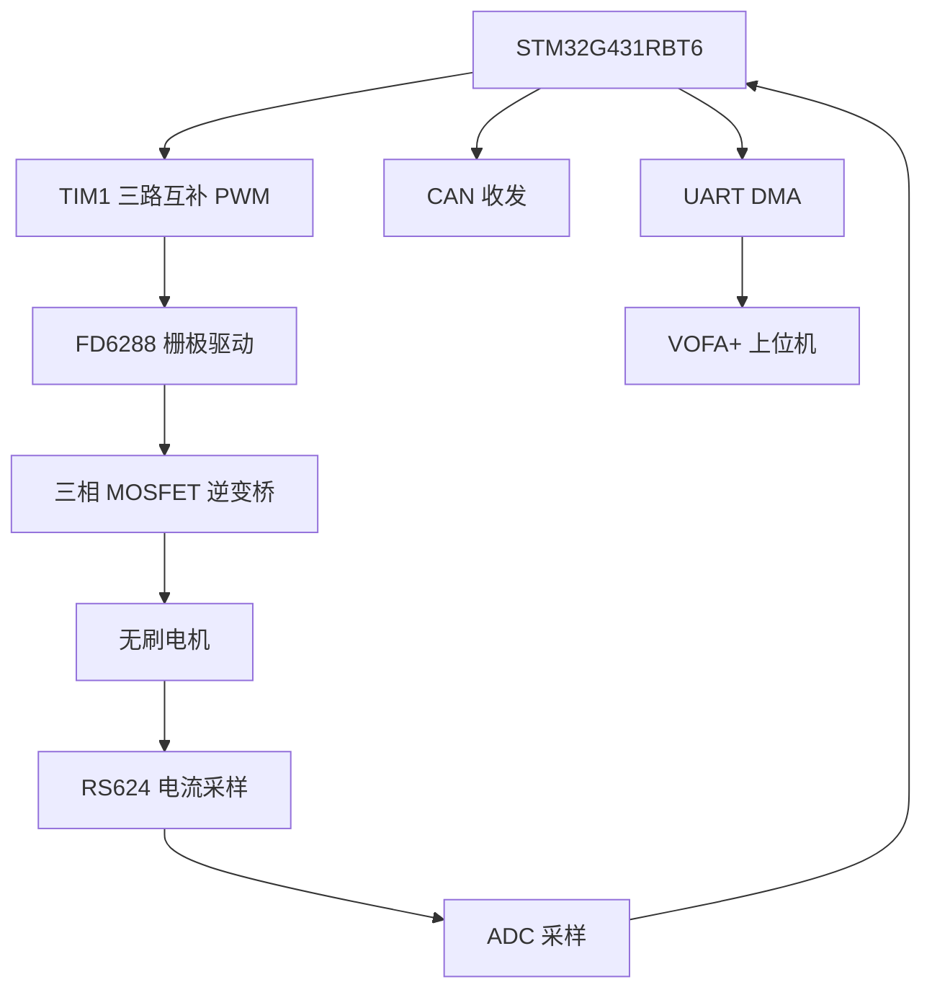

# STM32G431 FOC 六层控制板

> 双路 FOC 控制板：从原理图、六层 PCB 到 SVPWM 固件与上位机波形联调，完整走通一条电机控制硬件链路。

<!-- 封面图占位：把实物图放到 assets/images/projects/foc-cover.jpg，然后取消下面注释 -->
<!--  -->

!!! note "项目状态"
    硬件已完成原理图、PCB 与上电调试，固件实现 **V/f 开环电压调制 + SVPWM**，尚未完成电流闭环。本文按实际完成度记录，不夸大闭环效果。

## 1. 项目概述

本项目是一块基于 **STM32G431RBT6** 的双路 FOC 控制板，目标是把“电机控制板”从原理图、PCB、焊接调试到固件生成三相调制波形的完整流程走一遍。

板卡集成双路 **FD6288 栅极驱动**、三相 MOSFET 逆变桥、**RS624 电流采样**、CAN 通信与多路电源电路，PCB 为 **六层板**，在布局阶段完成了叠层规划与关键走线的阻抗控制。

| 项目 | 内容 |
| --- | --- |
| 主控 | STM32G431RBT6（Cortex-M4，带高级定时器） |
| 栅极驱动 | FD6288 ×2（双路） |
| 功率级 | 三相 MOSFET 逆变桥 |
| 电流采样 | RS624 |
| 通信 | CAN、UART |
| PCB | 六层板，含叠层与阻抗规划 |
| 开发环境 | Keil MDK、VOFA+ |

## 2. 硬件设计

### 2.1 系统框图



### 2.2 六层板设计要点

- **叠层规划**：六层板为 PWM、采样与电源提供独立的走线和参考平面。
- **阻抗控制**：对关键走线做阻抗匹配，降低开关噪声对采样通道的影响。
- **功率与弱电共存**：板上同时存在三相功率回路、栅极驱动和毫伏级电流采样，Layout 需要同时照顾功率回路长度与采样回路的干净程度。

<!-- 图片占位：PCB 3D 图 / 叠层截图 -->
<!--  -->

## 3. 控制算法与固件

### 3.1 三相调制链路

固件中的调制链路为：

1. 由 V/f 速度控制根据目标频率计算电角度；
2. 对电压矢量做 **反 Park / 反 Clarke 变换**；
3. 注入**零序分量**，提高母线电压利用率；
4. 计算 **SVPWM 占空比**，写入 TIM1 三路互补 PWM 比较寄存器；
5. 由定时中断驱动控制状态机，按固定周期更新电角度与占空比。

!!! warning "边界说明"
    当前实现为 **V/f 开环**：电角度由给定频率积分得到，没有编码器/无感观测器反馈，也没有电流环。后续计划再补电流采样闭环。

### 3.2 定时器与 DMA

- **TIM1** 输出三路互补 PWM，带死区配置，驱动 FD6288。
- 定时中断中推进控制状态机与电角度。
- **UART DMA** 将转速、电角度、三相调制波形打包上传到 VOFA+，用于观察波形与定位时序问题。

```c
/* 伪代码：定时中断中的调制更新 */
void TIM1_UP_IRQHandler(void) {
    angle += step;                 /* V/f：由频率积分电角度 */
    park_clarke_inverse(angle, vq, vd, &valpha, &vbeta);
    svpwm_calc(valpha, vbeta, &duty_a, &duty_b, &duty_c);
    set_pwm(TIM1, duty_a, duty_b, duty_c);
}
```

## 4. 调试与验证

- **上电顺序**：先测各路电源轨，再上驱动，最后接电机，降低炸管风险。
- **PWM 验证**：用示波器看三路互补波形、死区时间与占空比变化。
- **相电压观察**：通过 VOFA+ 上传三相调制波形，检查马鞍波与零序注入是否正常。
- **问题定位**：配合 Keil 在线调试，检查定时器计数、比较值与中断周期是否一致。

<!-- 图片占位：示波器波形 / VOFA 界面 -->
<!--  -->

## 5. 技术栈

`STM32G431` · `C` · `SVPWM` · `FOC` · `六层 PCB` · `Altium Designer` · `TIM1 互补 PWM` · `UART DMA` · `VOFA+` · `Keil`

## 6. 复盘与后续

- 六层板能上电并跑通调制，关键是把电源、驱动、采样分开考虑，而不是一味追求走线好看。
- 目前只做到开环调制，可继续完善的方向：
    - 接入 RS624 采样做电流环；
    - 加入过流、过压、堵转保护；
    - 用编码器或无感观测器替代 V/f 开环角度。

## 7. 资料与链接

- 原理图 / PCB 工程：待补充
- 演示视频：待补充
- 代码仓库：待补充
