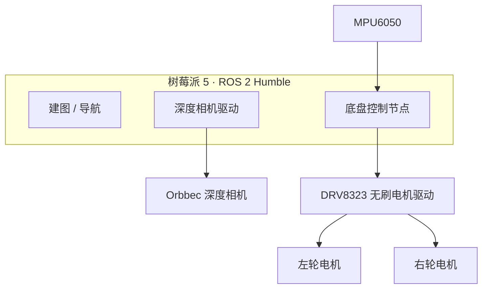

# ROS 2 移动机器人底盘

> 在树莓派 5 + ROS 2 Humble 上接入深度相机与无刷电机底盘，完成建图、导航验证，并梳理 25 个 ROS 功能包的调用链路。

<!-- 封面图占位：把实物图放到 assets/images/projects/ros2-cover.jpg，然后取消下面注释 -->
<!--  -->

## 1. 项目概述

本项目是移动机器人底盘的核心硬件与嵌入式部分：以 **树莓派 5 + ROS 2 Humble** 为上位平台，接入 **Orbbec 深度相机**，配合 **DRV8323 无刷电机驱动** 与 **MPU6050** 姿态采集，完成底盘运动控制与建图、导航验证。

除了把车跑起来，项目还做了一件容易被忽略的事：把 25 个 ROS 功能包的节点、话题、服务与 launch 启动链路完整梳理成 15 页技术文档，记录依赖关系和接口问题。

| 项目 | 内容 |
| --- | --- |
| 上位机 | 树莓派 5 |
| 系统 | Ubuntu + ROS 2 Humble |
| 感知 | Orbbec 深度相机 |
| 电机驱动 | DRV8323（无刷电机） |
| 姿态 | MPU6050 |
| 文档 | 25 个功能包梳理，15 页技术文档 |

## 2. 系统组成

### 2.1 平台接入

- 在树莓派 5 上部署 Ubuntu + ROS 2 Humble；
- 接入 Orbbec 深度相机，跑通驱动与点云/图像话题；
- 完成建图与导航功能验证。

### 2.2 运动控制

- 使用 DRV8323 驱动无刷电机；
- MPU6050 采集姿态数据，参与底盘运动控制与软硬件联调。

## 3. 系统梳理

ROS 2 项目最容易出问题的地方不是算法，而是“谁发布、谁订阅、谁先启动”。为此我逐个功能包梳理了：

- **节点**：每个包启动哪些节点，节点之间如何通信；
- **话题 / 服务**：消息类型、发布频率、坐标系约定；
- **launch 链路**：启动顺序、参数文件、依赖关系；
- **接口问题**：版本不匹配、话题名不一致、TF 缺失等。

最终形成 15 页技术文档，作为后续调试和交接的依据。

<!-- 图片占位：RViz 建图截图 / 系统框图 -->
<!--  -->

## 4. 调试思路

- **相机无数据**：先确认驱动包版本与相机型号匹配，再看对应 topic 是否有消息；
- **底盘不动**：从 cmd_vel 话题 → 底盘节点 → DRV8323 使能信号逐段排查；
- **建图漂移**：检查 IMU 数据与 TF 树，确认里程计与深度数据的时间同步；
- **启动顺序**：用 launch 文件固定依赖，减少手动起节点的遗漏。

## 5. 技术栈

`ROS 2 Humble` · `树莓派 5` · `Ubuntu / Linux` · `Orbbec 深度相机` · `DRV8323` · `MPU6050` · `Python / C++` · `RViz`

## 6. 复盘

- 机器人项目里，**系统集成能力**和算法同样重要：能把 25 个包的关系讲清楚，比多调一个参数更有价值。
- 文档不是额外工作，而是调试工具；接口问题记录得越早，后面踩坑越少。
- 可继续完善的方向：补充底盘 URDF 与 TF 标定，完善导航参数，做更长距离的闭环测试。

## 7. 资料与链接

- 技术文档：待补充
- 演示视频：待补充
- 代码仓库：待补充
