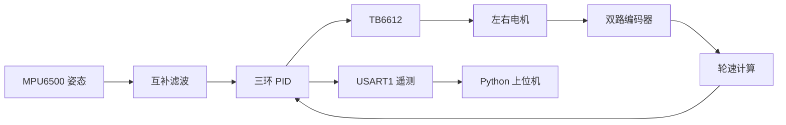

# STM32 两轮平衡车

> 100 Hz 控制环 + MPU6500 + 双编码器 + TB6612：从姿态融合、三环 PID 到状态机与 Python 上位机，独立完成一辆能站、能跑、能自动起立的平衡车。

<!-- 封面图占位：把实物图放到 assets/images/projects/balance-cover.jpg，然后取消下面注释 -->
<!--  -->

## 1. 项目概述

基于 **STM32F103VET6** 的两轮自平衡小车。控制环跑在 **100 Hz** 定时中断里，融合 **MPU6500** 姿态数据与**双路编码器**轮速，通过 **TB6612** 驱动两个直流电机，搭建角度、速度、转向三环控制框架。

除了“能平衡”，项目还加入了陀螺零偏校准、倾倒停机、自动起立与紧急停止，并用状态机管理 `IDLE`、`RUN`、`FALLEN`、`STANDUP` 四种工况。

| 项目 | 内容 |
| --- | --- |
| 主控 | STM32F103VET6 |
| 姿态 | MPU6500（六轴 IMU） |
| 轮速 | 双路编码器 |
| 电机驱动 | TB6612 |
| 控制频率 | 100 Hz |
| 人机交互 | OLED、按键、USART1 |
| 上位机 | Python 串口可视化 |

## 2. 控制架构



### 2.1 三环控制

- **角度环**：维持车身直立，是平衡车的核心环；
- **速度环**：根据编码器轮速控制前进/后退速度；
- **转向环**：根据目标转向量控制左右轮差速。

三环输出共同参与 TB6612 的 PWM 与方向控制。

### 2.2 姿态融合

MPU6500 提供加速度与角速度。使用**互补滤波**融合两者：

- 加速度计低频可信，用于修正长期漂移；
- 陀螺仪高频可信，用于快速响应；
- 上电时做**陀螺零偏校准**，减少静态漂移。

```c
/* 伪代码：互补滤波，alpha 按实际调试确定 */
float angle = alpha * (angle + gyro_rate * dt) + (1 - alpha) * acc_angle;
```

## 3. 状态机与保护

| 状态 | 含义 | 进入条件 / 动作 |
| --- | --- | --- |
| `IDLE` | 待机 | 上电初始化完成，电机不输出 |
| `RUN` | 正常运行 | 车身姿态在可控范围内 |
| `FALLEN` | 倾倒 | 倾角超过阈值，立即停机 |
| `STANDUP` | 自动起立 | 从倾倒状态尝试重新扶正 |

保护措施：

- **倾倒停机**：倾角超限立即关闭电机输出；
- **自动起立**：在安全前提下给一个短时力矩把车身扶正；
- **紧急停止**：按键触发，立即切断电机输出。

## 4. 调试与可视化

- **OLED**：显示姿态角、轮速、控制输出与当前状态；
- **按键**：切换状态、启停、参数微调；
- **USART1**：按固定格式上报姿态、轮速、PID 输出；
- **Python 上位机**：串口解析并实时绘图，用于观察波形、整定 PID 参数、定位异常。

<!-- 图片占位：上位机曲线 / 实物图 -->
<!--  -->

## 5. 技术栈

`STM32F103VET6` · `C` · `MPU6500` · `双路编码器` · `TB6612` · `互补滤波` · `PID` · `状态机` · `OLED` · `USART1` · `Python`

## 6. 复盘

- 平衡车最难的不是“站起来”，而是**站起来之后还能稳**：机械重心、传感器安装角度、PID 参数三者必须一起调。
- 把控制环固定在 100 Hz，并用上位机看实时曲线，比盲调参数效率高得多。
- 状态机让保护逻辑变得清晰：什么时候该停、什么时候能起立，一目了然。
- 可继续完善的方向：无线遥控、电池电量监测，以及用 FreeRTOS 重构任务调度。

## 7. 资料与链接

- 原理图 / 代码：待补充
- 演示视频：待补充
- 代码仓库：待补充
